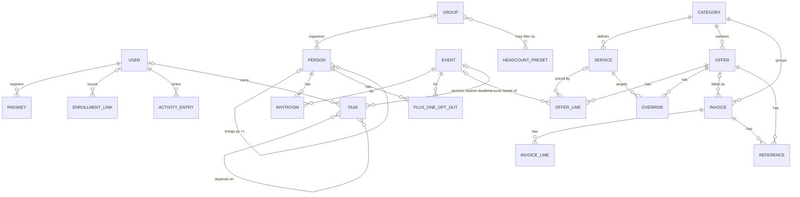

# Domain Model

This is a conceptual model. Names, cardinalities and rules are binding; storage layout is not.

**Settings** is deliberately absent from the diagram: it is a singleton with no
relationships. A task's optional navigable link to a category, offer, invoice or event
(TSK-01) is also omitted, to keep the diagram readable; only the relative-deadline anchor
is shown.

## Entities

### User
Display name. Owns zero or more passkeys. Exactly two users in practice; the system SHOULD NOT hard-code the number but needs no user administration beyond enrollment. There is no deletion, renaming or deactivation of users in v1.

### Passkey
Belongs to a user. WebAuthn credential material, a user-editable name ("Wannes' phone"), registration moment and last-used moment (AUTH-08).

### Enrollment link
A single-use, expiring token (AUTH-06) in one of three flavours:
- **device** — issued by a user, registers an additional passkey for *that same user* (AUTH-04)
- **user invitation** — issued by a user, creates a *new* user with a display name chosen at creation and registers their first passkey (AUTH-05)
- **recovery** — generated by an operator release command for an existing user who has lost every device (AUTH-09); it has no issuing user

Has an issuing user (absent for recovery links), a target user (absent for user-invitation links until the link is used), an expiry moment, a used-at moment and a revoked-at moment.

### Person
Optional first name, optional last name, age category, want tier, certainty, notes. Optional group. Optional *guest of* (host) — if set, the person is a +1. A +1 has a *name known* flag and a *+1 status* (*possible* / *confirmed*). See `modules/guests-and-events.md`.

**Name** is two separate optional fields plus a derived display name, not one free-text field: the guest list must sort by last name (PER-05) and CSV exports them as separate columns (XC-30). Both are optional so that a one-word name ("Oma") and an unnamed +1 both work. A person whose *name known* flag is false has neither and displays as "+1 of ⟨host⟩" (PER-11); any other person MUST have at least one of the two.

### Plus-one opt-out
Person × Event. Records that a +1 does **not** attend one event that its host does (PER-13). It exists only for persons that are +1s, is the only per-event state a +1 has, and is deliberately *not* an Invitation — +1s have no invitations of their own. Absence of an opt-out means the +1 follows its host.

### Group
Name, optional type label (household, circle…). Contains zero or more persons. A person belongs to at most one group.

### Event
Name, optional date (calendar date, no time zone), optional location (free text), sort order, notes.

### Invitation
Person × Event → status: *planned*, *invited*, *accepted*, *declined*. Absence of an invitation means *not invited*. +1s do not have their own invitations; see rules.

### Headcount preset
Name + filter criteria. Evaluated live; never stores a number.

### Category
Name, target amount (optional), sort order.

### Service
Belongs to a category. Name, wanted priority (*not wanted* / *nice-to-have* / *must-have*), sort order.

### Offer
Belongs to a category. Vendor name, optional URL, notes, status, VAT basis, optional minimum spend, *planning pick* flag, *invoicing complete* flag, frozen service selection (set on confirmation), references.

### Offer line
Belongs to an offer. Refers to a service **or** has an ad hoc label. State, pricing basis, amount (Money), event, optional included quantity, optional minimum charge, optional VAT rate, *invalid* flag. The **event is required** for *per adult*, *per child* and *per attendee* lines (CST-31) and absent for *flat* lines. A service may have several lines in one offer (e.g. adult and child rates). A line whose event has been deleted is flagged invalid and contributes nothing (XC-42).

### Override
Offer × Service → on/off. Deviates from the category's wanted priority for that one offer.

### Invoice
Belongs to a category, optionally to an offer. Label/number, invoice date, optional due date, paid flag + paid date, lines, references.

### Invoice line
Label, amount (Money).

### Reference
Label + either an uploaded file or a URL. Attached to an offer or an invoice.

### Task
Title, notes, status, owner, deadline (none / fixed date / relative to event), dependencies, optional link to a category, offer, invoice or event.

**Owner** is an optional reference to a **user** plus a *shared* flag — not a fixed enumeration. Unassigned is no user and not shared; "both" is the shared flag. This keeps TSK-01 working if a third user is ever created through AUTH-05, which a four-value enum would not.

### Settings
A singleton. Holds the **overall budget** amount (BUD-01) and the **default time zone** used when the browser does not report one (NFR-22). Not related to anything; it exists because these two values belong to the application rather than to any entity.

### Activity entry
Timestamp (UTC), user, human-readable description, affected entity. See `04-cross-cutting.md`.
